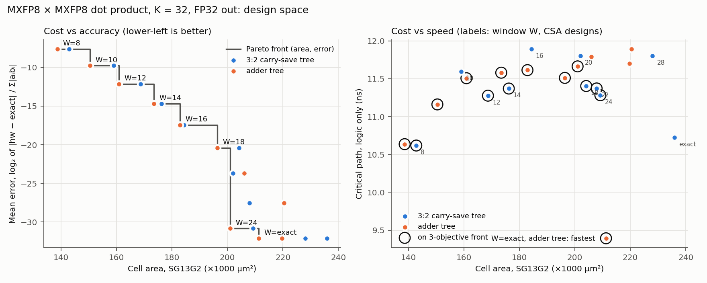

# Dot-Product Engine Generator (DotGen)

`DotGen` generates **block dot-product engines** for low-precision number formats
(OCP MX, plain minifloats, small integers, ternary), together with a bit-exact
reference model and a self-checking testbench, from a single command:

```bash
bin/hwx dot --a mxfp4 --b mxfp8 --block 32 --acc fp32 --pdk sg13g2 --verify --synth
```

```text
design      hwx_dot_mxfp4_mxfp8e4m3_k32_fp32
operation   result = round(2^(Xa-127)·2^(Xb-127)·Σ_{i<32} a_i·b_i) → fp32
elements    a: fp4 (4b + E8M0 scale)   b: fp8e4m3 (8b + E8M0 scale)
per lane    2×4 significand multiplier
alignment   exact (Kulisch): every product on one fixed-point grid, 22 magnitude bits
reduction   32 terms × 28b, 3:2 carry-save tree + 1 CPA
output      single normalize + round (rne) to fp32
pipeline    2 register stage(s), latency 2 cycle(s), 1 result/cycle

[verify] PASS: 9096 vectors, 0 mismatches
[synth] area 140488.9 µm²   cells 15905   flops 73   critical path 8.19 ns (logic only, no wires)
```

`bin/hwx` loads only `src/DotGen` (no LLVM/GPUCompiler), so it starts in about a second.
From Julia, use `using HWExplore.DotGen` (or `include("src/DotGen/DotGen.jl")`).

## Knobs

| option | values | meaning |
|---|---|---|
| `--a`, `--b` | `mxfp4`, `mxfp6e2m3`, `mxfp6e3m2`, `mxfp8` (E4M3), `mxfp8e5m2`, `mxint8`, `fp4`…, `int8`, `int4`, `int2`, `ternary` | element formats; `mx*` adds an E8M0 shared-scale input (`hwx formats` lists all) |
| `--block` | K | lanes per result |
| `--acc` | `fp32`, `bf16`, `fp16`, `int<N>` | output; `int<N>` saturates and is for integer × integer only |
| `--window` | `exact` or W | accumulator width: exact Kulisch, or W bits per aligned term |
| `--round` | `rne`, `rtz` | the single final rounding |
| `--tree` | `csa`, `adder` | compressor tree vs balanced adder tree |
| `--stages` | 0–3 | pipeline registers (output, + after the tree, + after the products) |

Mixed precision is just two different formats (`--a int4 --b int8`, `--a mxfp4 --b mxfp8`).

## Verification

- **Reference model** (`dot_ref`): mirrors the hardware algorithm in BigInt arithmetic.
- **Independent oracle** (`dot_oracle`): decodes elements to exact rationals, sums
  exactly, and rounds by binary search over the output code space. It shares no
  arithmetic with the reference model, and the two agree on every test vector.
- **Exhaustive** per-product sweeps where feasible (every FP4×FP4 pair is only 256 cases;
  FP8×FP8 is 65,536), plus structured random blocks: sparse, near-total cancellation,
  same-sign maximum magnitude, NaN/Inf injection, and scales chosen to force
  subnormal and overflowing results.
- **Verilator**: `--verify` builds a self-checking testbench and compares every output
  bit-exactly. Mutation checks confirm that it catches injected bugs (a wrong rounding mode,
  a one-bit error in one lane).

Tests: `julia --project=. tests/test_dotgen.jl`.

## Synthesis

`--synth` runs Yosys + ABC against a liberty file: `--pdk sg13g2` looks in `$HWX_LIBERTY`,
then `$PDK_ROOT/ihp-sg13g2/...`, then `synth/pdk/` (gitignored); `--pdk sky130` uses the
liberty vendored with X-HEEP. This is logic synthesis only: cell area and an ABC
critical-path estimate without wires. Use it to compare design points, not as sign-off numbers.

`examples/dot_sweep.jl` verifies and synthesizes a set of design points and writes
`synth/results/dot_sweep_<pdk>.csv`. Current SG13G2 results (typical corner, K=32, FP32 output
unless noted, 2 pipeline stages, every point bit-exact in Verilator first):

| design | sum bits | area µm² | cells | logic path ns |
|---|---:|---:|---:|---:|
| mxfp4×mxfp4 | 14 | 49,190 | 5,379 | 5.03 |
| mxfp4×mxfp8 (E4M3) | 28 | 140,489 | 15,905 | 8.19 |
| mxfp4×mxfp8, adder tree | 28 | 163,443 | 18,423 | 8.58 |
| mxfp4×mxfp8, window 16 | 22 | 161,130 | 18,100 | 10.68 |
| mxfp6×mxfp6 (E2M3) | 18 | 128,437 | 14,473 | 5.57 |
| mxfp8×mxfp8 (E4M3) | 42 | 235,903 | 26,686 | 10.72 |
| mxfp8×mxfp8, window 16 | 22 | 184,301 | 20,864 | 11.89 |
| mxfp8×mxfp8 (E5M2) | 70 | 258,114 | 28,362 | 14.03 |
| mxint8×mxint8 | 21 | 237,402 | 26,926 | 6.38 |
| ternary×mxfp8 | 24 | 87,244 | 9,484 | 8.24 |
| int4×int8 → int32 | 17 | 116,674 | 13,377 | 4.43 |
| int8×int8 → int32 | 21 | 245,946 | 28,192 | 4.76 |
| ternary×int8 → int32 | 14 | 43,377 | 4,936 | 3.45 |

What this shows so far:

- The **compressor tree beats the adder tree** by 14% area at the same function.
- **Exact accumulation is not automatically the expensive option.** For FP4×FP8 the Kulisch
  sum is only 28 bits, and a 16-bit window is *larger*, because it adds a block-max tree and
  variable right shifters. The window only pays off once the exact width grows: for FP8×FP8
  (42 bits) it saves 22%.
- **Ternary weights** cost 5.7× less area than INT8×INT8, and 2.7× less than FP4×FP8.
- MXFP4×MXFP4 is 4.8× smaller than MXFP8×MXFP8. Accuracy decides whether that trade is worth it.

## Worked example: the Pareto frontier of one operation

`examples/pareto_mxfp8_dot.jl` explores a single operation, the **MXFP8 (E4M3) × MXFP8 dot product,
K = 32, FP32 out**. It varies the alignment window W ∈ {8, 10, …, 24, 28, exact} and the tree
style, and measures three objectives, all minimized:

- **area**: SG13G2 cell area (Yosys + ABC);
- **delay**: ABC's logic-only critical path;
- **error**: mean `|hw − exact| / Σ|aᵢbᵢ|` on 2,000 blocks of realistic data. The data is N(0,1)
  activations with 2% ×30 outlier channels and N(0,1) weights, quantized to MXFP8 as in
  OCP MX §6.3. "Exact" is the exact dot product of the *quantized* values, so the metric
  measures only what the hardware adds on top of quantization.



**How the front is found.** Design A *dominates* B when A is no worse on every objective and
strictly better on at least one; the Pareto front is the set of designs nobody dominates
(`pareto_front`, `dominators`). Every design off the front has a named replacement that is
at least as good on all axes. The script prints that replacement, and it checks every front
design bit-exactly in Verilator.
